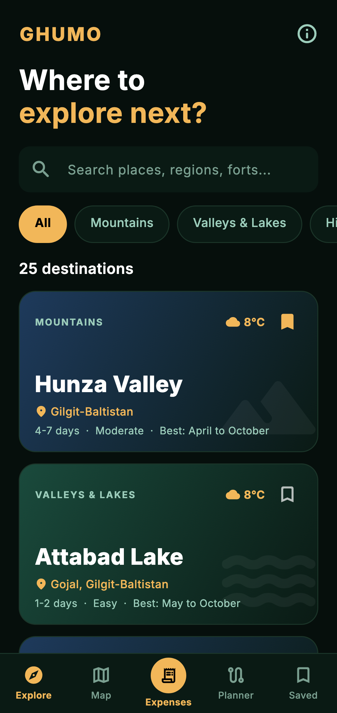
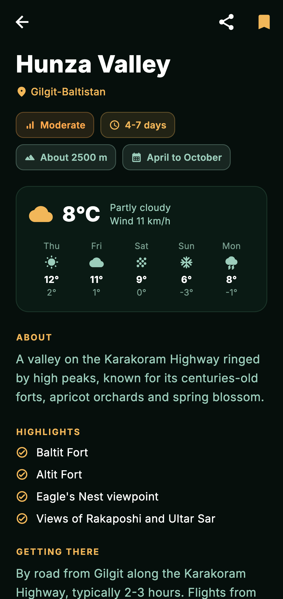
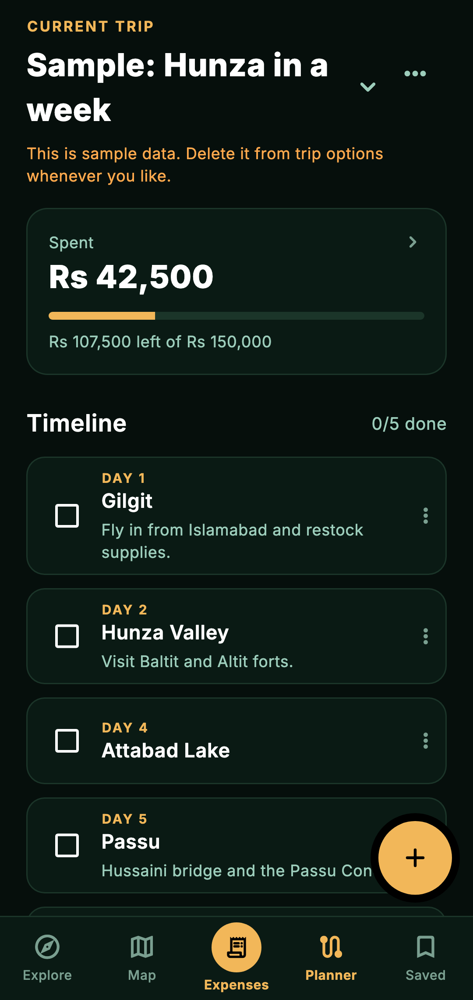
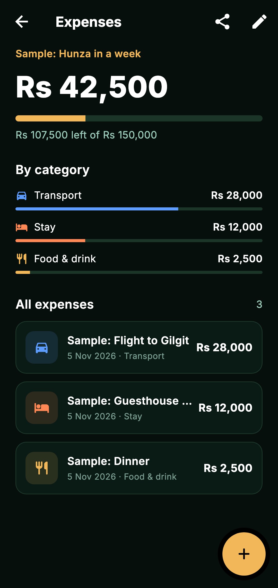
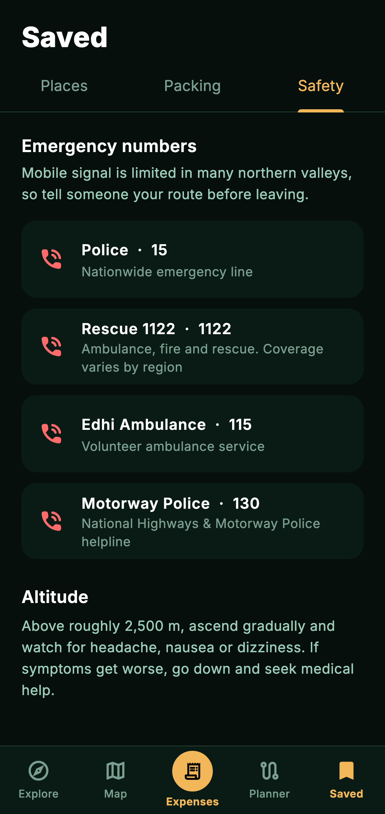

# Ghumo

**Explore the unexplored.** Ghumo is a travel companion for Pakistan, built with Flutter. It combines a destination guide, live maps, trip planning and expense tracking in one app, with no account needed.

| Explore | Destination | Planner | Expenses | Safety |
|---|---|---|---|---|
|  |  |  |  |  |

Screenshots are rendered from the app by a test, using sample data and canned weather.

## Features

- **Destination guide:** 25 places across Pakistan with search, categories, best season, difficulty and how to get there. Works offline.
- **Live weather:** current conditions and a 5-day forecast from Open-Meteo.
- **Maps:** standard, topographic and satellite styles, with your real location.
- **Routes:** driving distance and time from OSRM. If no route is available, the app shows a clearly labelled straight-line distance and no made-up drive time.
- **Nearby places:** real fuel stations, hospitals and mechanics from OpenStreetMap.
- **Trip planner:** multiple trips, day-by-day stops, reordering, progress and itinerary sharing.
- **Expenses:** per-trip budgets in PKR, category breakdowns, swipe to delete with undo, and summary sharing.
- **Packing and safety:** an editable checklist, tap-to-call emergency numbers and altitude advice.
- **Private by design:** your data stays on the device.

## Architecture

```
lib/
  data/       Bundled destination guide and emergency contacts
  models/     Domain models with JSON serialisation
  services/   Weather, routing, nearby search and location
  state/      AppStore (ChangeNotifier), storage interface, AppScope (DI)
  screens/    UI, one file per screen, map code in screens/map/
  widgets/    Shared UI and forms
  utils/      Money, date and distance formatting
```

Key decisions:

- **State:** a single `AppStore` is exposed through an `InheritedNotifier`, so the app needs no state-management dependency. Every change is saved as versioned JSON, and corrupt data falls back to defaults rather than crashing.
- **Testability:** `AppStorage` and the injected `http.Client` let tests run with no plugins or network.
- **Offline first:** the guide, planner, expenses, fonts and emergency numbers need no connection. Network features show loading and error states, and retry where it makes sense.
- **Map tiles:** tiles you have viewed are cached on the device. There is deliberately no "download region" feature, because the public tile servers' usage policies prohibit bulk downloading.

## Install the APK

1. Download the APK from the [Releases](https://github.com/umar2334/Ghumo/releases) page. `arm64-v8a` suits most modern phones, and the universal build works on any phone.
2. Open the file on your Android phone, and allow installs from your browser if asked.

Requires Android 7.0 or newer.

## Run from source

Requires Flutter 3.38 or newer.

```bash
flutter pub get
flutter run                 # Android or Chrome
flutter analyze
flutter test
flutter test --tags screenshots --run-skipped --update-goldens   # Regenerate screenshots
```

## Release build

Create `android/key.properties` (gitignored), pointing at your own keystore:

```properties
storeFile=ghumo-release.jks
storePassword=...
keyAlias=ghumo
keyPassword=...
```

Then run `flutter build apk --release --split-per-abi`. Without that file, release builds use debug signing.

## Credits and data

Map data © [OpenStreetMap](https://www.openstreetmap.org/copyright) contributors. Topographic tiles by [OpenTopoMap](https://opentopomap.org/about). Satellite imagery by Esri. Weather by [Open-Meteo](https://open-meteo.com/). Routing by [OSRM](https://project-osrm.org/). Inter font under the [SIL Open Font License](assets/fonts/OFL.txt).

The public OSRM and Overpass servers are community resources without uptime guarantees. A production release at scale should use hosted or paid equivalents.

Travel information is general guidance. Always confirm road, permit and security conditions locally.
